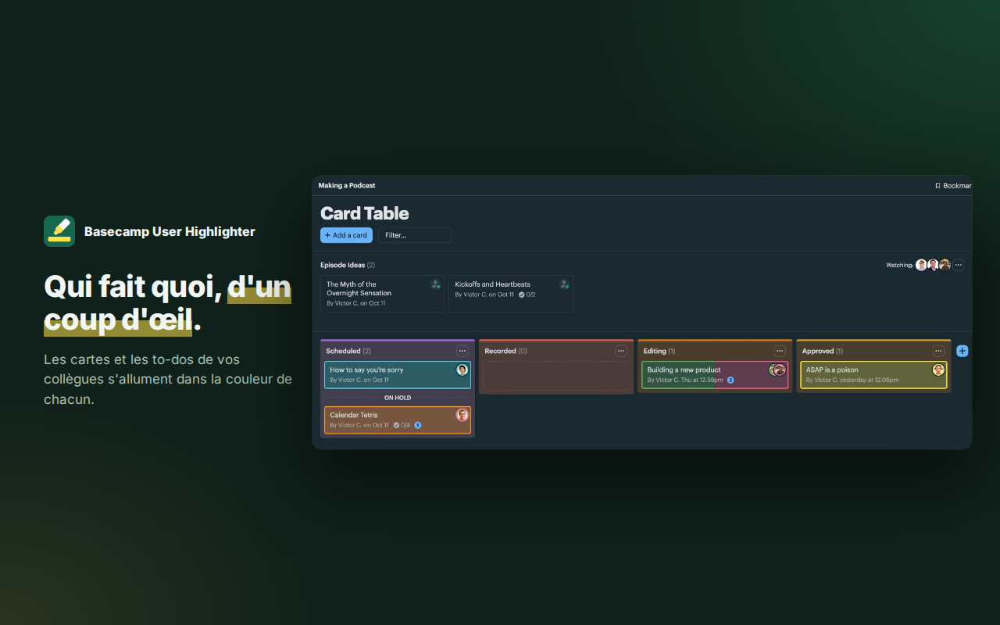

<p align="center"></p>

<h1 align="center">Basecamp User Highlighter</h1>

<p align="center">
  <b>Spot your teammates' work at a glance.</b><br>
  A Chrome / Firefox extension that lights up Basecamp cards and to-dos in each person's color.
</p>

<p align="center">
  <a href="https://lepetitpaco.github.io/basecamp-user-highlighter/">Website</a> ·
  <a href="https://lepetitpaco.github.io/basecamp-user-highlighter/privacy.html">Privacy</a>
</p>



## Features

- **One color per person** on card tables, to-do lists and My Tasks. A task shared by several highlighted people shows all their colors.
- **No ids to look up**: everyone you meet in Basecamp shows up in the popup's quick add, one click away and searchable, or right-click an avatar. Each new person gets a free color, and the color picker opens right away.
- **Task count per person** on the current page, in the popup.
- **Options**: intensity, dim everyone else's tasks, border only.

Only assignees count: the "Added by" avatar and subscribers don't trigger a highlight.

**No tracking, no network requests of its own, nothing changed on your Basecamp account.** People, the names and avatar addresses of those met in Basecamp, and settings stay in the extension's local storage. The interface is in French. The permissions are `storage`, `contextMenus`, `scripting` and access to `app.basecamp.com` and `3.basecamp.com`.

## How it works

- `src/settings.js`: storage (same keys as 1.0, existing people are kept), palette and color helpers, shared by the popup and the content script.
- `src/highlight.js`: finds the assignee avatars and highlights their task, once per frame through a single `MutationObserver` (Turbo swaps content and lazy frames load the assignees).
- `popup.js`: people, palette and options.
- `background.js`: right-click menu, plus two helpers for unpacked builds only, fired from a Basecamp tab: `basecamp-user-highlighter:dev-reload` reloads the extension, `basecamp-user-highlighter:dev-storage` sets its storage from `<html data-bh-dev-storage>`.

## Development

```sh
scripts/use.sh chrome    # or firefox: copies the matching manifest to manifest.json
scripts/package.sh       # packages/basecamp-user-highlighter-{chrome,firefox}.zip
```

- Chrome: `chrome://extensions` → Developer mode → "Load unpacked" → this folder.
- Firefox (140+): `about:debugging#/runtime/this-firefox` → "Load Temporary Add-on" → `manifest.json` (after `scripts/use.sh firefox`). Then allow the extension on Basecamp: the popup offers a button.
- Store texts: [`store/CHROME.md`](store/CHROME.md) and [`store/FIREFOX.md`](store/FIREFOX.md). Website: `site/`, published by `.github/workflows/pages.yml`.
- `store/render.sh` renders the icons from `store/icon.svg` and the store visuals from the real screenshots of `store/captures` (Basecamp's sample project, taken by hand: logging in can't be scripted).

## License

[MIT](LICENSE). Basecamp User Highlighter is an independent project, not affiliated with or endorsed by Basecamp or 37signals.
